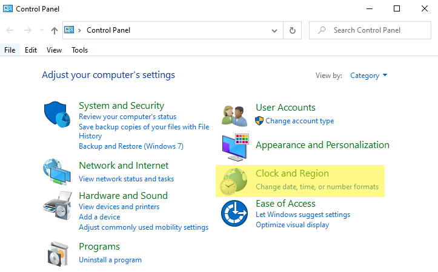
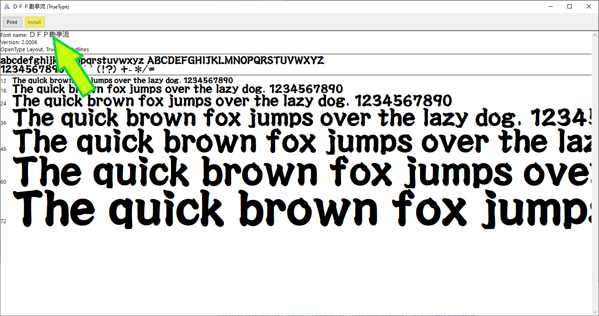

# 
**Welcome to the Taiko no Tatsujin (太鼓の達人) Simulator Guide**

# Prerequisites
*All simulators have certain requirements and installations needed before they can be run properly.*

## How to Change your System Locale
##### **This will NOT change your system's display language!**

***What is your system locale?*** 
&nbsp;&nbsp;&nbsp;&nbsp;Your system locale is how your computer displays non-unicode text in programs. 
***Why do you need to change it?*** 
&nbsp;&nbsp;&nbsp;&nbsp;In order to display Japanese text, which is a requirement for simulators, your locale needs to be set to Japanese so that your computer can parse songs with Japanese names and load any song audio. 
This process is slightly different for Win7/WinXP.

<ol>
<li>Go to your <b>Control Panel</b> in Windows, using the search bar or using the shortcut in the Windows menu.</li>
<li>Then, go to the <b>Clock and Region</b> tab.</li> 
</img>
<li>Select <b>Region</b>, and click the <b>"Administrative"</b> panel.</li> 
</img>  
<li>Hit the <b>"Change system locale..."</b> button and select <b>"Japanese (Japan)"</b>. <b>DO NOT hit the checkmark underneath!</b></li>
<li>Restart your computer, and you're all done!</li>
</ol>

## Install the Taiko no Tatsujin Fonts
*Your computer does not come with the necessary fonts used in most modern simulators, so they need to be manually installed.*

1. Download the required fonts.
	- **[DFPKanteiryu-XB (DFB勘亭流-XB)](https://drive.google.com/file/d/1Au8BzkPLCIunt-GypA4qvkUtpwGnKisp/view) | Required**
	- **[FOT-Ōedo Kanteiryu Std E (FOT-大江戸勘亭流 Std E)](https://drive.google.com/file/d/1OKbd2f4lGFwLkkp3wiENsybwc6VvLc6r/view) | Required for Nijiiro (ニジイロ) style simulators**

2. Double click on the font file to install. 

3. In certain TJAPlayer3 simulators, specifying the font is required. In config.ini, change: 
`FontName=ＤＦＰ勘亭流` for normal font 
`FontName=FOT-大江戸勘亭流 Std E` for Nijiiro font 

No restart is required after font installation. 

_For the standard taiko font, extra compatibility has been added to select songs. In order to enable this compatibility, the song names in the TJA file must be changed._ 
`‽カオスタイム‽` 
`亜空間遊泳ac⒓` 
`アルムジカac⒕.0V` 
`毒ⅬCANⅮ♡` 
`poxei♢DOON` 
`(Any song with !!) -> ‼` 

## How to Obtain Songs
*Finding songs can be tricky, especially for people who can't speak or read Japanese. This guide provides reliable sources for finding good quality charts (TJAs) and audio. Please make sure your simulator is working before you download songs.*

### TJADB
TJADB is the most up-to-date and efficient way to find the highest quality audio and charts, mainly for official songs. Custom songs are also included in a separate user submission channel. At this time, all songs that are available in 太鼓の達人グリーン 2.0 (Green Version Japan + Asia) are available. You can find TJADB on Discord **[here](https://discord.gg/XHcVYKW)**. A website will soon be available too!
#### GetUploader
GetUploader, otherwise known as "uploader.jp" or "ux.getuploader.com", is where many Japanese TJA creators and users upload their works online. Sources from here can be of varying quality, and a large majority of them are custom. Zen Gaido Fumen Haifu (全難易度譜面配布) is a generally good source on the website with up to date official charts and a variety of customs. Songs that are marked "本家譜面" are official. It is split into 4 links. Songs cannot be downloaded in bulk. 

- [Pack 1](https://ux.getuploader.com/e2339999zp/)
- [Pack 2](https://ux.getuploader.com/e2337650/)
- [Pack 3](https://ux.getuploader.com/toukyuutoyoko9000/)
- [Pack 4](https://ux.getuploader.com/e2351000)

Songs can also be found using GetUploader by going to google and using the format "song name" + site:getuploader.com.

#### Other Sources

Songs can be found in other places on the web, such as [taikosanjiro-humenroom](https://taikosanjiro-humenroom.net), which features Oni (or Omote (表)) and Ura (裏) custom and official charts. Anything beyond that can be found with google and the term 太鼓さん次郎 + "Song name".

***
### 
**Continue to [TJAPlayer3 Forks and Simulators](https://tjadataba.se/tjap)**

***

