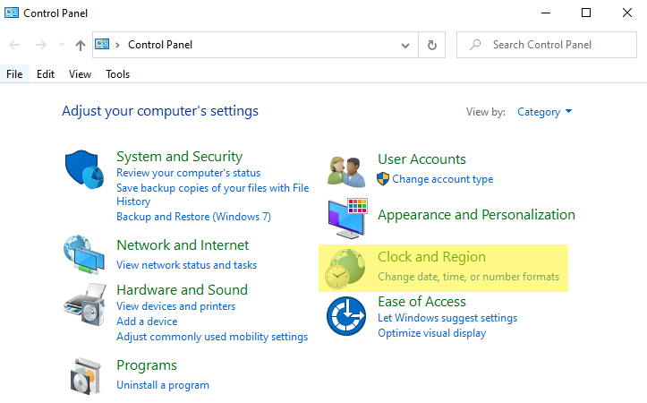
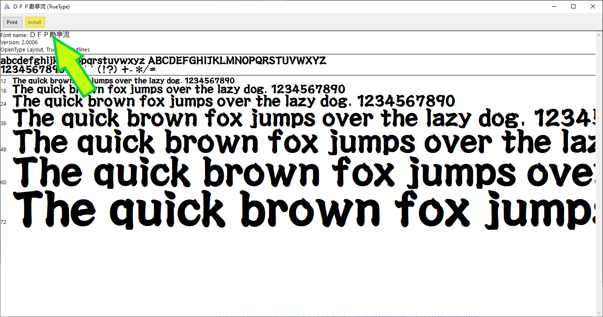

# 
**Bem-vindo ao Guia do Simulador Taiko no Tatsujin (太鼓の達人)**

# Pre-requisitos
*Todos os simuladores têm certos requisitos e instalações necessários antes que possam ser executados corretamente.*

## Como alterar a localidade do seu sistema
##### **Isso NÃO mudará o idioma exibido no seu sistema!**

***Qual é a localidade do seu sistema?*** 
&nbsp;&nbsp;&nbsp;&nbsp;A localidade do sistema é como o computador exibe texto não unicode nos programas. 
***Porque eu preciso mudar?*** 
&nbsp;&nbsp;&nbsp;&nbsp;Para exibir texto em japonês, que é um requisito para simuladores, sua localidade precisa ser definida como japonesa para que seu computador possa analisar músicas com nomes japoneses e carregar qualquer áudio de música. This process is slightly different for Win7/WinXP.
<ol>
<li>Vá para o seu <b>Painel de Controle</b> no Windows, usando a barra de pesquisa ou usando o atalho no menu do Windows.</li>
<li>Em seguida, vá para a guia <b>Relógio e região</b>.</li> 
</img>
<li>Selecione <b>Região</b> e clique no painel <b>"Administrativo"</b>.</li> 
</img>  
<li>Clique no botão <b>"Alterar localidade do sistema..."</b> e selecione <b>"Japonês (Japão)"</b>. <b>NÃO clique na marca de seleção abaixo!</b></li>
<li>Reinicie o computador e pronto!</li>
</ol>

## Instale as fontes Taiko no Tatsujin
*Seu computador não vem com as fontes necessárias usadas na maioria dos simuladores modernos, então elas precisam ser instaladas manualmente.*

1. Baixe as fontes necessárias.
	- **[Dom Casual Std + DFPKanteiryu-XB (DFB勘亭流-XB)](https://drive.google.com/file/d/1Au8BzkPLCIunt-GypA4qvkUtpwGnKisp/view) | Required for TJAPlayer3**
	- **[FOT-Ōedo Kanteiryu Std E (FOT-大江戸勘亭流 Std E)](https://drive.google.com/file/d/1OKbd2f4lGFwLkkp3wiENsybwc6VvLc6r/view) | Required for Nijiiro (ニジイロ) style simulators**
	- **[DFPKanteiryu-XB (DFB勘亭流-XB)](https://drive.google.com/file/d/1Au8BzkPLCIunt-GypA4qvkUtpwGnKisp/view) | Required for any other simulator**

2. Clique duas vezes no arquivo de fonte para instalar. 

3. Em certos simuladores TJAPlayer3, é necessário especificar a fonte. Em config.ini, mude: 
`FontName=ＤＦＰ勘亭流` para fonte normal e inglês híbrido 
`FontName=FOT-大江戸勘亭流 Std E` para fonte Nijiiro 

Nenhuma reinicialização é necessária após a instalação da fonte. 

_Para a fonte taiko padrão, foi adicionada compatibilidade extra para selecionar músicas. Para habilitar essa compatibilidade, os nomes das músicas no arquivo TJA devem ser alterados._ 
`!? = ⁉` 
`?! = ⁈` 
`⒑ = 10` 
`⒒ = 11` 
`⒓ = 12.5` 
`⒕ = 14` 
`Ⅼ = LO` 
`Ⅾ = DY` 
`‼ = !!` 
`‽ = !!!` 
`❢ = !!!!` 
`there is one for !!!!!` 
`℣ = vs` 
`♢ = poxei doon diamond` 
`：= :` 
`🐠 = a fish in taiko font` 
`ﻼ = a dolphin in taiko font` 

## Como Obter Musicas
*Encontrar músicas pode ser complicado, especialmente para pessoas que não falam ou lêem japonês. Este guia fornece fontes confiáveis ​​para encontrar gráficos de boa qualidade (TJAs) e áudio. Certifique-se de que seu simulador está funcionando antes de baixar músicas.*

### <B>TJADB</b> (Recomendado)
O TJADB é a maneira mais atualizada e eficiente de encontrar áudios e gráficos da mais alta qualidade, principalmente para músicas oficiais. As músicas personalizadas também estão incluídas em um canal de envio de usuários separado.  
No momento em que escrevo isso, o projeto ESE (Every Song Ever) está completo e inclui TODOS os mapas e músicas oficiais de taiko. Você pode encontrar o TJADB no Discord [aqui](https://discord.gg/XHcVYKW).  
Para músicas personalizadas de alta qualidade, visite <a href="https://dev.pidgey.net">https://dev.pidgey.net</a> para obter o banco de dados TJADB personalizado completo.

#### GetUploader
GetUploader, também conhecido como "uploader.jp" ou "ux.getuploader.com", é onde muitos criadores e usuários japoneses de TJA enviam seus trabalhos online. As fontes daqui podem ser de qualidade variável, e a grande maioria delas é personalizada. .
As músicas também podem ser encontradas usando o GetUploader acessando o Google e usando o formato "nome da música" + site:getuploader.com.

#### Outras fontes

As músicas podem ser encontradas em outros lugares na web, como [taikosanjiro-humenroom](https://taikosanjiro-humenroom.net), que apresenta Oni (ou Omote (表)) e Ura (裏) paradas personalizadas e oficiais. Qualquer coisa além disso pode ser encontrada com o google e o termo 太鼓さん次郎 + "Nome da música".

***
### 
**Continue para [TJAPlayer3 Forks e Simuladores](https://tjadataba.se/tjap)**

***

