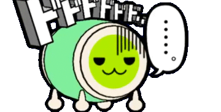
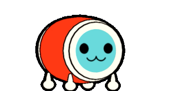
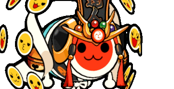
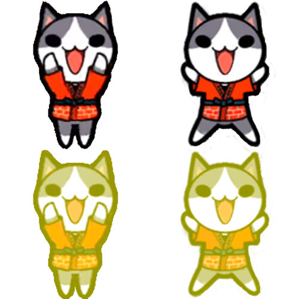
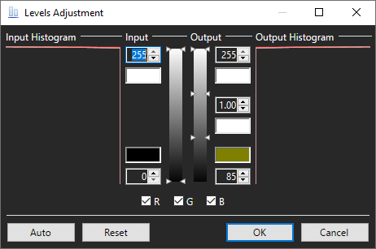

# Simuladores y "Forks" de TJAPlayer3
_TJAPlayer es un software originalmente basado en "DTXMania", un simulador de Drummania. El término "fork" viene del desarrollo general de software, que es el acto de copiar el código fuente del proyecto y desarrollarlo sin alterar el código original._  
<b> Atajos de teclado globales para TJAPlayer3</b> 
`SHIFT + F1 = Ajustes` 
`DEL = Activa el menú de Debug` 
`F1 = Pausa (en el juego)` 
`F3 = Modo Automático (J1)` 
`F4 = Modo Automático (J2) (en la selección de canción)` 
`F5 = Reproducción de video AVI (en el juego)` 
`F6 = Modo de desplazamiento/scroll de las notas` 
`F7 = Modo del indicador/gauge` 
`F12 = Captura de pantalla` 
`DFJK = Teclas por defecto del taiko` 
`Flechas ARRIBA y ABAJO = Incrementa o disminuye la velocidad de las notas (mientras juegas)` 
`Flechas DERECHA e IZQUIERDA = Incrementa o disminuye el desfase global de la canción (mientras juegas) (no recomendado)` 
`ALT + Flechas DERECHA e IZQUIERDA = Incrementa o disminuye el desfase global en 1ms` 
`SHIFT + Flechas ARRIBA y ABAJO = Incrementa o disminuye el desfase de la canción (mientras juegas)` 
`ALT + SHIFT + Flechas ARRIBA y ABAJO = Incrementa o disminuye el desfase de la canción en 1ms` 
`/ = Controla el volumen de la canción / previsualización de la canción` 
`F2 en la lista de canciones = Opciones rapidas` 

## <b>OpenTaiko</b> (Recomendado)
OpenTaiko es el fork mas reciente actualmente desarrollado y mantenido por 申しコミ (0AuBsq). Este simulador es el más cercano a la ultima arcade, Nijiiro (ニジイロ). 
[Descarga](https://github.com/0auBSQ/OpenTaiko/releases/) 
[Link del servidor oficial de Discord](https://discord.gg/djTCsWj4th)

## TJAPlayer3
TJAPlayer3 es la base de la mayoría de los simuladores modernos. Todos los simuladores de este sitio son versiones modificadas de TJAPlayer3. El simulador fue oficialmente desarrollado por AioiLight, y es mantenido por twopointzero y Meowgister. 
[Versión preconfigurada de Meowgister](https://drive.google.com/drive/folders/1qit5aYGK1TBh6qMOKBkKeqqXnO3Ckfig)

## TJAPlayer3GL
TJAPlayer3GL es un "port" de TJAPlayer3 hecho con OpenGL. Esta versión es útil para computadores con poca cantidad de RAM o tarjetas gráficas poco potentes. 
<a href="https://discord.gg/t7dwc2Nm3a">https://discord.gg/t7dwc2Nm3a</a>

## TJAPlayer3-f
TJAPlayer3-f es un fork mantenido actualmente por Mr Ojii. Esta versión arregla una gran cantidad de errores, código espagueti, y otros problemas importantes esparcidos a lo largo del TJAPlayer3 original. Esta será la primera versión de TJAPlayer3 compatible de forma nativa con Linux. Solo el modo de juego automatico está disponible. 
<a href="https://github.com/Mr-Ojii/TJAPlayer3-f/releases">https://github.com/Mr-Ojii/TJAPlayer3-f/releases</a>

## TaikoCatsCaffe
TaikoCatsCaffe (TCC) es un simulador obsoleto creado por el equipo "!TaikoCatsCaffe!" y es la versión mas cercana a las arcades de 3ra generación (ver. 2011 - Green).
_Este simulador ya no está disponible ya que existen alternativas mucho mejores_

# Herramientas y extras

## Placa de identificación ("Nameplates")
_Nota: esta herramienta solo se necesita si estás usando TJAPlayer3 estandar o un simulador obsoleto._ **_OpenTaiko soporta de manera nativa las placas sin usar imagenes._**

Placas personalizadas pueden ser creadas gracias al "CRCR's nameplate program", el cual puede ser descargado <a href="../assets/Name Plate Maker.zip">Aquí.</a> 
Este es una placa de ejemplo. Tu título (usualmente obtenido por completar ciertos desafíos) van en la parte superior de la placa, y tu nombre de usuario por debajo. 
El botón de "Full" cambia entre la placa completa, y la estándar. Debes presionar "Save" dos veces para recibir ambas placas. 
El botón de "P" cambia entre los diseños del jugador 1 (J1) y el jugador 2 (J2). 
El botón de "On / Off" activa o desactiva el "dan" (dojo). Los dans son una forma de medir tu habilidad. Puedes encontrar más información en el <a href="https://discord.gg/XHcVYKW">Discord de TJADB.</a> 
Deja los archivos de la nameplate en `5 Game\6 Taiko` dentro de la carpeta base de la skin.
</img>

## Don-chan ("Dons")
Descárgalos haciéndo click a la imagen, luego extrae el zip y mueve los archivos a \11_Characters. Los archivos del Don tienen que estár en carpetas numeradas en orden (0,1,2,3...)

|Nombre	     |Creador		|					|
|    	     |	  		|					|		
|AI-Don      |りゅう/Ryu 		| |
|Dodododo....|まいるど_Mairudo	| 	|
|Don-chan (Ver. Red )|			| 	|
|Don-chan (Ver. Green)|			| 	|
|Katsu-chan  |			| |
|Sakuramochi Don|まいるど_Mairudo  | 	|
|Tatsujin    |			| 	|

## "Puchichara"

Los "Puchichara" son pequeños personajes que bailan junto a tu Don. Para usarlos en un simulador, simplemente añade la imagen a la carpeta `System\5_Game\18_PuchiChara\`.

### Crear tu propio Puchichara

_Esta guía no funcionará en OpenTaiko_
1. Instala [paint.net](https://www.getpaint.net/). Este será usado para añadir el efecto del "GoGo Time".

2. Encuentra dos imágenes del personaje que quieras usar como puchichara.

3. Reordena tus personajes en una plantilla similar a esta en un documento de 500x500px. (Puedes descargar esta plantilla y superponer tus personajes.)
</img>
4. Selecciona con un rectángulo los dos personajes inferiores de la imagen y ve a la pestaña de "Niveles" de paint.net.
5. Ajusta los niveles para que se vean así.  
</img>
6. Guarda el archivo.
