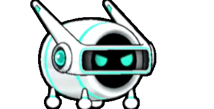
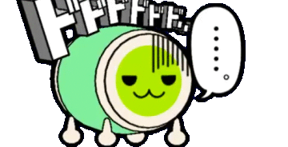
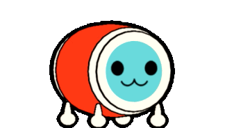
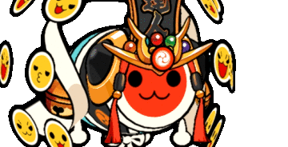
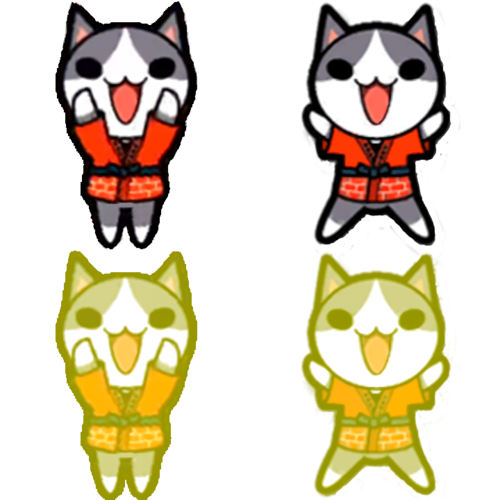
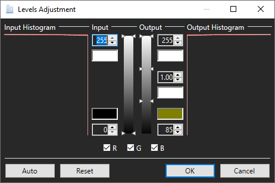

# TJAPlayer3 Forks and Simulators
_TJAPlayer is a software originally based off of DTXMania, a simulator for Drummania. The term "fork" comes from general software development, which is the act of copying the source code of a project and developing it without impacting the original code._  
<b>Global TJAPlayer3 Keybinds</b> 
`SHIFT + F1 = Settings Menu` 
`DEL = Enable Debug Overlay` 
`F1 = Pause (In game)` 
`F3 = Auto mode (1P)` 
`F4 = Auto mode (2P) (Song Select)` 
`F5 = AVI Playback (in-game)` 
`F12 = Screen Capture` 
`DFJK = default taiko keybinds` 
`UP and DOWN arrow keys = increase or decrease scroll speed (in-game)` 
`LEFT and RIGHT arrow keys = increase or decrease global offset (in-game) (not recommended)` 
`ALT + LEFT and RIGHT arrow keys = increase or decrease global offset in 1ms increment` 
`/ = Control song / song preview volume` 
## <b>TaikoCatsCaffe</b> (Recommended)
TaikoCatsCaffe (TCC) is a simulator created by the !TaikoCatsCaffe! Team and is the closest version to the generation 3 arcade systems (2011 ver - Green). 
Below is a modified version with bug fixes, more english text and other features. 
[Download](https://drive.google.com/file/d/1DsWVq_AFJIhqd8AQ24jdVypblCXfOQO5/view?usp=sharing) 
`New Update:` 
`Removed unused score history (fixes looping bug in log)` 
`Improved some textures` 
`Added New genre: NewSongs` 
`Don-chan is now normal size`  
`Keybinds:` 
`F4 = Enable Achievement Display (In-game)` 
`Space bar = Sort Songs`

## TJAPlayer3
TJAPlayer3 is the base for most modern simulators. TaikoCatsCaffe, TaikoCatsDooooN and many other simulators are modified versions of TJAPlayer3. The simulator was originally developed by AioiLight, and it is now maintained by twopointzero. 
<a href="https://github.com/twopointzero/TJAPlayer3/releases/latest/">https://github.com/twopointzero/TJAPlayer3/releases/latest/</a>
## TJAPlayer3-Develop
TJAPlayer3-Develop is a project that was created by KabanFriends and maintained by brian218. This simulator is the closest to the latest arcade version, Nijiiro (ニジイロ). 
<a href="https://github.com/TJAPlayer3-Develop/TJAPlayer3-Develop/releases/latest/download/TJAPlayer3-Develop.zip">Download (Final)</a>
## TJAPlayer3GL
TJAPlayer3GL is a port of TJAPlayer3 for OpenGL. This version is useful for people who have low RAM or weak graphics cards. 
<a href="https://discord.gg/t7dwc2Nm3a">https://discord.gg/t7dwc2Nm3a</a>

## TJAPlayer3-f
TJAPlayer3-f is a fork currently maintained by Mr Ojii. This version hopes to fix many of the bugs, spaghetti code, and other major issues littered throughout the original TJAPlayer3. This will soon be the first version of TJAPlayer3 to natively support Linux. 
<a href="https://github.com/Mr-Ojii/TJAPlayer3-f/releases">https://github.com/Mr-Ojii/TJAPlayer3-f/releases</a>

## TaikoReStart
TaikoReStart is a simulator with <b>malware included</b> and you should <b>never download or run.</b>

# Tools and Extras

## Nameplates
Custom Nameplates can be created thanks to CRCR's nameplate program, which can be downloaded <a href="../assets/Name Plate Maker.zip">Here.</a> 
This is an example name plate. Your title (usually gained from completing certain challenges) goes in the top box, and your username in the bottom. 
The "Full" button switches between the full and standard nameplate. You must hit "Save" twice to recieve both nameplates. 
The "P" button switches between the 1P and 2P design. 
The "On / Off" button switches the dan design on and off. Dans are a way to measure your skill. Find more information in the <a href="https://discord.gg/XHcVYKW">TJADB discord.</a> 
</img>

## Dons
**These Dons are for TaikoCatsCaffe (TCC) ONLY.** Download by clicking the image, then place and extract the zip file in System\Base\.

|Name 	     |Creator		|					|
|    	     |	  		|					|		
|AI-Don      |りゅう/Ryu 		| |
|Dodododo....|まいるど_Mairudo	| 	|
|Don-chan    |	(Comes with TCC)| 	|
|Don-chan (Red Ver)|	        | 	|
|Katsu-chan  |			| |
|Sakuramochi Don|まいるど_Mairudo  | 	|
|Tatsujin    |			| 	|

## Puchichara

Puchichara are small characters that dance alongside your Don. TaikoCatsCaffe includes many of these puchichara ready to be used. To load them in TCC, simply rename the image Puchichara.png and leave in in the 0_Personal folder. For any other version of TJAPlayer3, the file must be called 0.png and stored in 5_Game\18_Puchichara\.

### How to create Puchichara

1. Install [paint.net](https://www.getpaint.net/). This will be used to add the gogo time effect.

2. Find two images of the character you want to turn into a puchichara.

3. Arrange your characters in a fashion similar to this within a 500x500px canvas. (Feel free to download and overlay your characters.)
</img>
4. Rectangle Select the two characters at the bottom of the image and go to the "Levels" tab within paint.net.
5. Set your levels to look like this.  
</img>
6. Save the file.
