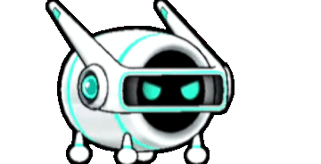
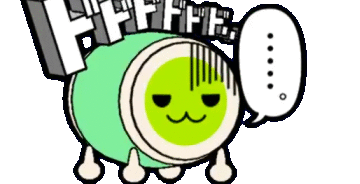
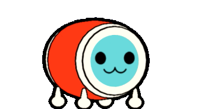
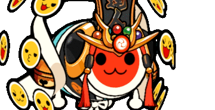
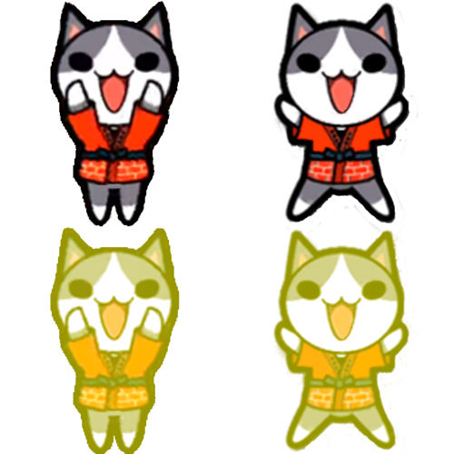
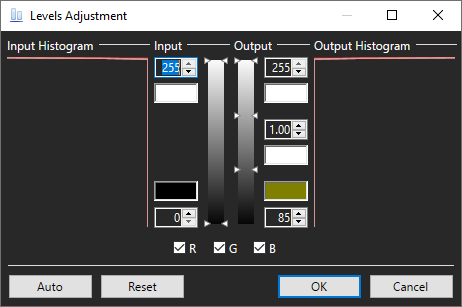

# TJAPlayer3 Forks and Simulators
_TJAPlayer is a software originally based off of DTXMania, a simulator for Drummania. The term "fork" comes from general software development, which is the act of copying the source code of a project and developing it without impacting the original code._  
<b>Global TJAPlayer3 Keybinds</b> 
`SHIFT + F1 = Settings Menu` 
`DEL = Enable Debug Overlay` 
`F1 = Pause (In game)` 
`F3 = Auto mode (1P)` 
`F4 = Auto mode (2P) (Song Select)` 
`F5 = AVI Playback (in-game)` 
`F6 = Scroll mode` 
`F7 = Gauge mode` 
`F12 = Screen Capture` 
`DFJK = default taiko keybinds` 
`UP and DOWN arrow keys = increase or decrease scroll speed (in-game)` 
`LEFT and RIGHT arrow keys = increase or decrease global offset (in-game) (not recommended)` 
`ALT + LEFT and RIGHT arrow keys = increase or decrease global offset in 1ms increment` 
`SHIFT + UP and DOWN arrow keys = increase or decrease song offset (in-game)` 
`ALT + SHIFT + UP and DOWN arrow keys = increase or decrease song offset in 1ms increment` 
`/ = Control song / song preview volume` 
`F2 In Song Select = Quick Options` 

## <b>OpenTaiko</b> (Recommended)
OpenTaiko is the most recent fork currently maintained by 申しコミ (0AuBsq). This simulator is the closest to the Gen 4 version of taiko. 
<a href="https://github.com/0auBSQ/OpenTaiko/releases/">Download</a>
<a href="https://discord.gg/djTCsWj4th">https://discord.gg/djTCsWj4th</a>

## TJAPlayer3
TJAPlayer3 is the base for most modern simulators. All simulators on this page are modified versions of TJAPlayer3. The simulator was originally developed by AioiLight, and was maintained by twopointzero and Meowgister. 
<a href="https://drive.google.com/drive/folders/1qit5aYGK1TBh6qMOKBkKeqqXnO3Ckfig">Preconfigured version by Meowgister</a>
## TJAPlayer3GL
TJAPlayer3GL is a port of TJAPlayer3 for OpenGL. This version is useful for people who have low RAM or weak graphics cards. 
<a href="https://discord.gg/t7dwc2Nm3a">https://discord.gg/t7dwc2Nm3a</a>

## TJAPlayer3-f
TJAPlayer3-f is a fork currently maintained by Mr Ojii. This version hopes to fix many of the bugs, spaghetti code, and other major issues littered throughout the original TJAPlayer3. This will soon be the first version of TJAPlayer3 to natively support Linux. However, only autoplay is available. 
<a href="https://github.com/Mr-Ojii/TJAPlayer3-f/releases">https://github.com/Mr-Ojii/TJAPlayer3-f/releases</a>

## TaikoCatsCaffe
TaikoCatsCaffe (TCC) is a <b>deprecated</b> simulator created by the !TaikoCatsCaffe! Team and is the closest version to the generation 3 arcade systems (2011 ver - Green). 
<i>This simulator is no longer available for download due to the creation of much better alternatives.</i>

# Tools and Extras

## Nameplates
<i>Note: This tool is only needed if using standard TJAPlayer3 or a deprecated simulator. <b>OpenTaiko natively supports nameplates without images.</b></i>  
Custom nameplates can be created thanks to CRCR's nameplate program, which can be downloaded <a href="../assets/Name Plate Maker.zip">here.</a> 
This is an example name plate. Your title (usually gained from completing certain challenges) goes in the top box, and your username in the bottom. 
The "Full" button switches between the full and standard nameplate. You must hit "Save" twice to recieve both nameplates. 
The "P" button switches between the 1P and 2P design. 
The "On / Off" button switches the dan design on and off. Dans are a way to measure your skill. Find more information in the <a href="https://discord.gg/XHcVYKW">TJADB discord.</a> 
Place the finished name plate in the base graphics folder and `5/game 6/taiko`. 
</img>

## Dons
Download by clicking the image, then place and extract the zip file in \11_Characters\. Don files have to be in numbered folders in order (0, 1, 2, 3, etc).

|Name 	     |Creator		|					|
|    	     |	  		|					|		
|AI-Don      |りゅう/Ryu 		| |
|Dodododo....|まいるど_Mairudo	| 	|
|Don-chan (Green Ver)    |	| 	|
|Don-chan (Red Ver)|	        | 	|
|Katsu-chan  |			| |
|Sakuramochi Don|まいるど_Mairudo  | 	|
|Tatsujin    |			| 	|

## Puchichara

Puchichara are small characters that dance alongside your Don. To load them in a simulator, simply add an image to the `System/5_Game/18_PuchiChara/` folder.

### How to create Puchichara

<i>This guide will not work for OpenTaiko</i> 
1. Install [paint.net](https://www.getpaint.net/). This will be used to add the gogo time effect.

2. Find two images of the character you want to turn into a puchichara.

3. Arrange your characters in a fashion similar to this within a 500x500px canvas. (Feel free to download and overlay your characters.)
</img>
4. Rectangle Select the two characters at the bottom of the image and go to the "Levels" tab within paint.net.
5. Set your levels to look like this.  
</img>
6. Save the file.
