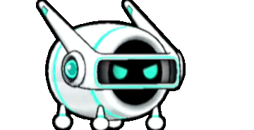
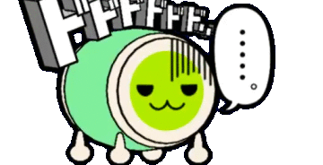
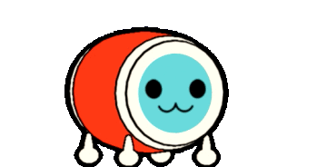
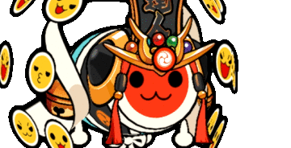
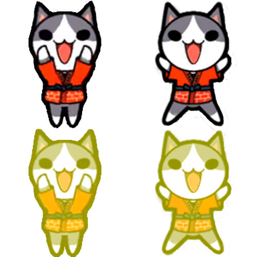
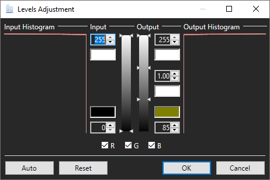

# TJAPlayer3 Forks and Simulators
_TJAPlayer é um software originalmente baseado no DTXMania, um simulador para Drummania. O termo "fork" vem do desenvolvimento geral de software, que é o ato de copiar o código-fonte de um projeto e desenvolvê-lo sem impactar o código original._  
<b>Teclas de atalho padrão do TJAPlayer3 </b> 
`SHIFT + F1 = Menu de configuração` 
`DEL = Ativar sobreposição de depuração` 
`F1 = Pausa (dentro do jogo)` 
`F3 = Modo automatico (1P)` 
`F4 = Modo automatico (2P) (seleção de Musicas)` 
`F5 = AVI Playback (Dentro do jogo)` 
`F6 = Scroll mode` 
`F7 = Gauge mode` 
`F12 = Captura de tela` 
`DFJK = atalhos de teclado padrão do taiko` 
`setas para ACIMA e para BAIXO = aumentar ou diminuir a velocidade de rolagem (dentro do jogo)` 
`setas para ESQUERDA e para DIREITA = aumentar ou diminuir o offset global (dentro do jogo) (não recomendado)` 
`ALT + setas para ESQUERDA e para DIREITA = aumentar ou diminuir o offset global por 1ms` 
`SHIFT + setas para ACIMA e para BAIXO = aumentar ou diminuir o offset da musica (dentro do jogo)` 
`ALT + SHIFT + setas para ACIMA e para BAIXO = aumentar ou diminuir o offset da musica por 1ms` 
`/ = Controlar a musica / volume da previa da musica` 
`F2 na seleção de musica = Configurações rapidas` 

## <b>OpenTaiko</b> (Recommended)
OpenTaiko é o fork mais recente atualmente mantido por 申しコミ (0AuBsq). Este simulador é o mais próximo da versão arcade mais recente, Nijiiro (ニジイロ). <a href="https://github.com/0auBSQ/OpenTaiko/releases/">Download</a> 
<a href="https://discord.gg/djTCsWj4th">https://discord.gg/djTCsWj4th</a>

## TJAPlayer3
TJAPlayer3 é a base para a maioria dos simuladores modernos. Todos os simuladores nesta página são versões modificadas do TJAPlayer3. O simulador foi originalmente desenvolvido pela AioiLight, e foi mantido pela twopointzero e pela Meowgister. 
<a href="https://drive.google.com/drive/folders/1qit5aYGK1TBh6qMOKBkKeqqXnO3Ckfig">Versão pré-configurada por Meowgister</a>
## TJAPlayer3GL
TJAPlayer3GL é um port de TJAPlayer3 para OpenGL. Esta versão é útil para pessoas que têm pouca RAM ou placas gráficas fracas. 
<a href="https://discord.gg/t7dwc2Nm3a">https://discord.gg/t7dwc2Nm3a</a>

## TJAPlayer3-f
TJAPlayer3-f é um fork atualmente mantido por Mr Ojii. Esta versão tenta corrigir muitos dos bugs, código de espaguete e outros problemas importantes espalhados pelo TJAPlayer3 original. Esta será em breve a primeira versão do TJAPlayer3 a oferecer suporte nativo ao Linux. No entanto, apenas a reprodução automática está disponível. 
<a href="https://github.com/Mr-Ojii/TJAPlayer3-f/releases">https://github.com/Mr-Ojii/TJAPlayer3-f/releases</a>

## TaikoCatsCaffe
TaikoCatsCaffe (TCC) é um simulador <b>obsoleto</b> criado pelo !TaikoCatsCaffe! Team e é a versão mais próxima dos sistemas de arcade da geração 3 (versão de 2011 - Verde). <i>Esse simulador não está mais disponível para download pela criação de outros simuladores.</i>

# Ferramentas e Extras

## Placas de identificação
<i>Nota: Esta ferramenta só é necessária se estiver usando o TJAPlayer3 padrão ou um simulador obsoleto. <b>O OpenTaiko suporta nativamente placas de identificação sem imagens.</b></i>  
Placas de identificação personalizadas podem ser criadas graças ao programa de placas de identificação da CECE, que pode ser baixado <a href="../assets/Nameplate Maker.zip">aqui.</a> 
Esta é uma placa de identificação de exemplo. Seu título (geralmente obtido ao completar certos desafios) vai na caixa superior e seu nome de usuário na parte inferior. 
O botão "Full" alterna entre a placa de identificação completa e padrão. Você deve clicar em "Save" duas vezes para receber as duas placas de identificação. 
O botão "P" alterna entre o design 1P e 2P. 
O botão "On / Off" liga e desliga o design dan. Dans são uma maneira de medir sua habilidade. Encontre mais informações no <a href="https://discord.gg/XHcVYKW">discord, TJADB. (Nota: O servidor é totalmente em inglês)</a> 
Coloque a placa de identificação finalizada na pasta de gráficos base e `5/game 6/taiko`. 
</img>

## Dons
Faça o download clicando na imagem, depois coloque e extraia o arquivo zip em \11_Characters\. Os arquivos não devem estar em pastas numeradas em ordem (0, 1, 2, 3, etc).

|Nome 	     |Criador		|					|
|    	     |	  		|					|		
|AI-Don      |りゅう/Ryu 		| |
|Dodododo....|まいるど_Mairudo	| 	|
|Don-chan (Green Ver)    |	| 	|
|Don-chan (Red Ver)|	        | 	|
|Katsu-chan  |			| |
|Sakuramochi Don|まいるど_Mairudo  | 	|
|Tatsujin    |			| 	|

## Puchichara

Puchichara são pequenos personagens que dançam ao lado de seu Don. Para carregá-los em um simulador, basta adicionar uma imagem à pasta `System/5_Game/18_PuchiChara/`.

### Como criar um Puchichara

<i>Este guia não funcionará para OpenTaiko</i> 
1. Instale [paint.net](https://www.getpaint.net/). Isso será usado para adicionar o efeito gogo time.

2. Encontre duas imagens do personagem que você deseja transformar em um puchichara.

3. Organize seus personagens de maneira semelhante a esta em uma tela de 500x500px. (Sinta-se à vontade para baixar e sobrepor seus personagens.)
</img>
4. Selecione os dois caracteres na parte inferior da imagem e vá para a guia "Níveis" no paint.net.
5. Defina seus níveis para ficar assim.  
</img>
6. Salve o arquivo.
