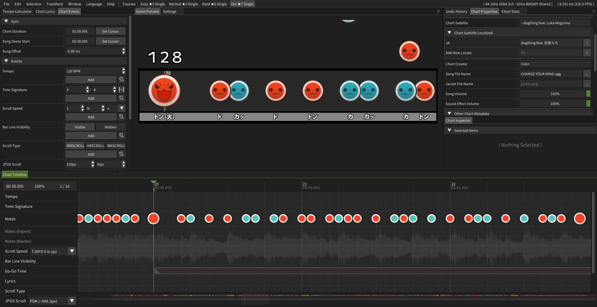

# Making Songs

Chart = Beatmap/Map, they are levels that you play to a piece of music.

Check out this great guide by ugyuu on how to create your own Taiko charts: [youtube.com/watch?v=U0i-z-tpxY8](https://www.youtube.com/watch?v=U0i-z-tpxY8)

Additionally, feel free to ask any chart-related questions in the [TJADB Discord's #tja-general channel!](https://discord.gg/XHcVYKW)

## Charting Tools

### PeepoDrumKit

PeepoDrumKit is the recommended tool to chart with. It features an easy to use GUI to create and edit TJA charts.

You can find the currently maintained download here: [github.com/IepIweidieng/PeepoDrumKit](https://github.com/IepIweidieng/PeepoDrumKit)

### TJA Tools

TJA Tools is a web based tool for visualizing TJA charts.

[whmhammer.github.io/tja-tools](https://whmhammer.github.io/tja-tools/)

### TJA Format and Syntax Reference (tja.md)

An unofficial compilation and commentation of the TJA format & its related formats. This is the most up to date reference material featuring nearly all headers, commands, and corner case information.

[github.com/IepIweidieng/TJAPlayer3/blob/gh-pages/tja.md](https://github.com/IepIweidieng/TJAPlayer3/blob/gh-pages/tja.md)
