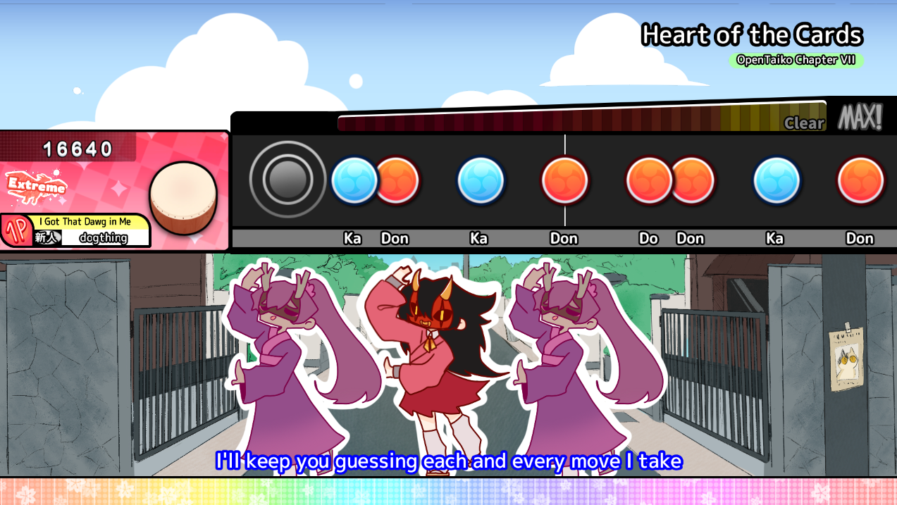
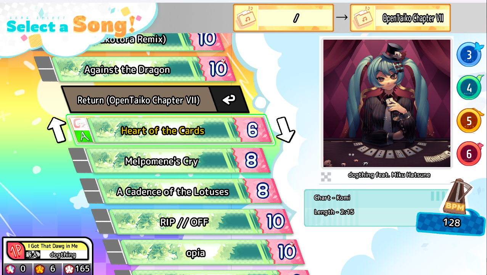

# OpenTaiko

An improved and personalized version of TJAPlayer3-Develop-Rewrite, a .tja chart player focused on entertainment and creativity. Currently only supports Windows, but Mac and Linux versions are planned for the future.

**Download:** [github.com/0auBSQ/OpenTaiko](https://opentaiko.github.io)

**Discord Server:** [discord.gg/aA8scTvZ6B](https://discord.gg/aA8scTvZ6B) (**any mention of Nijiiro Assets/Nijiiro skins, and ESE are strictly prohibited**)

Arcade-style skins are not supported for OpenTaiko, however it comes with many creative skins by default.

## Screenshots

