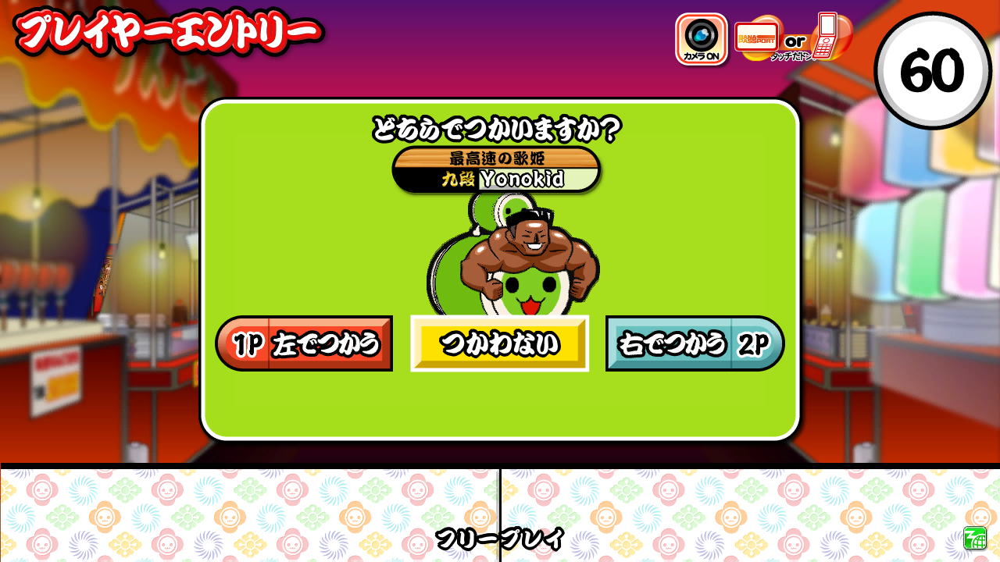
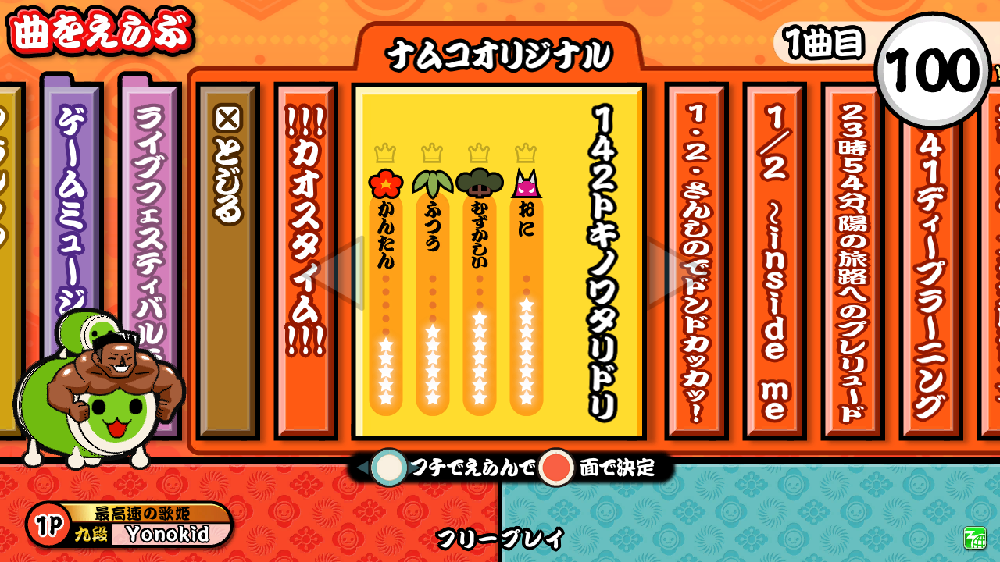
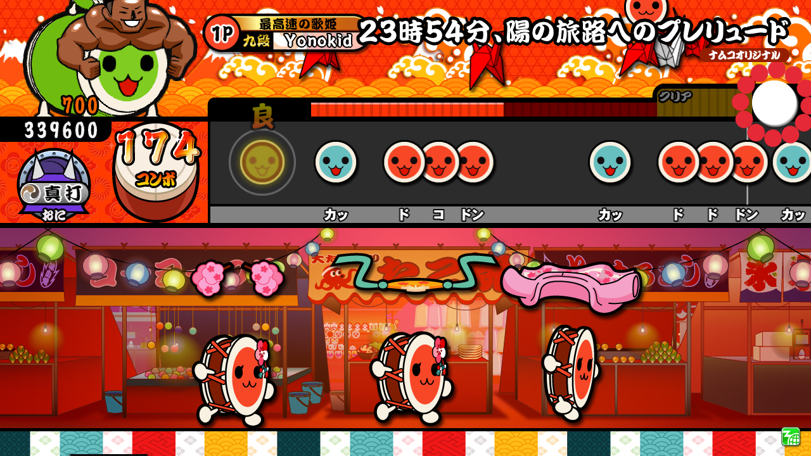
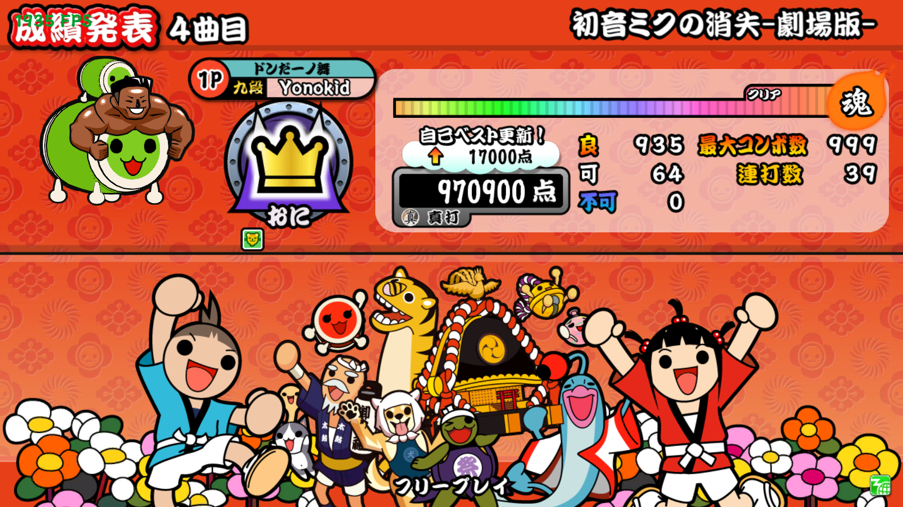
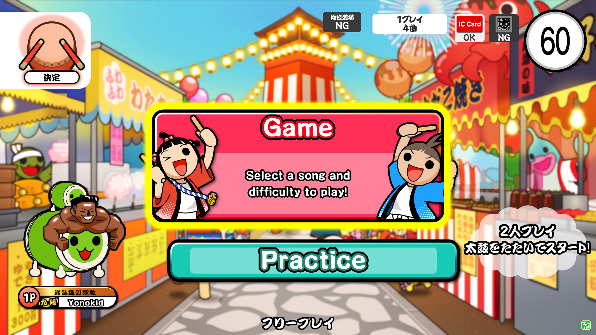
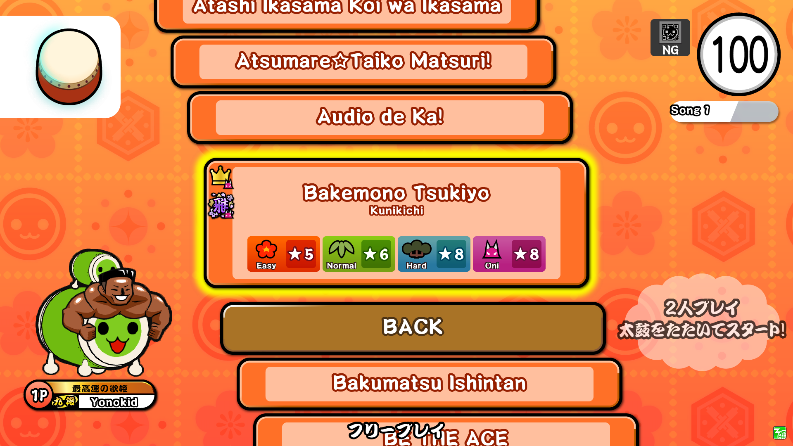
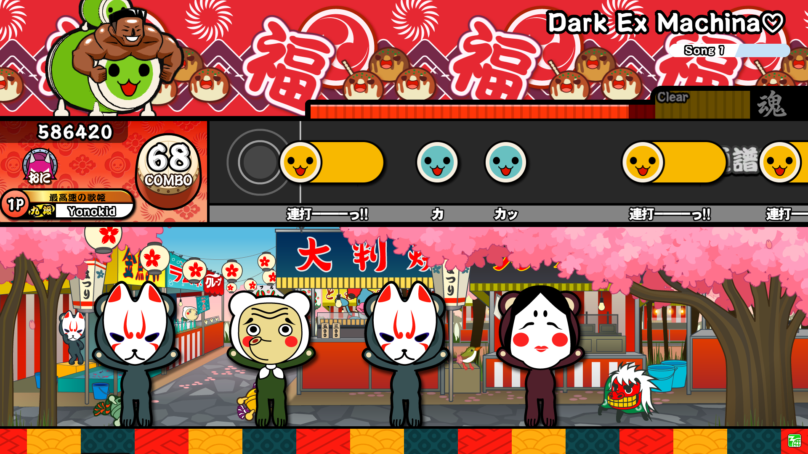
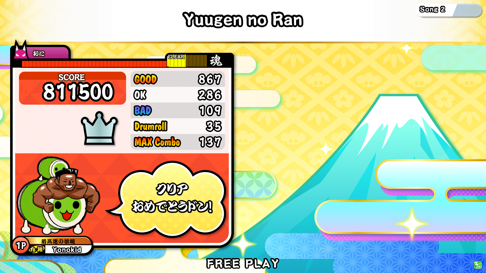

# YataiDON

An arcade style simulator.

**Download:** [github.com/Yonokid/YataiDON/releases](https://github.com/Yonokid/YataiDON/releases)

### Platforms supported

All platforms support the same features, but may have extra setup or different hardware requirements.

- Windows
- MacOS
- Linux
- Android
- iOS ([https://testflight.apple.com/join/ZzrXBUsb](https://testflight.apple.com/join/ZzrXBUsb))
- PS5
- Switch 1

### Skins

There are builtin skins that resemble:

- KATSU-DON to Red Version (YataiDONRed)
- Yellow Version to Green Version (PyTaikoGreen)
- Nijiiro Version (YataiDONNijiiro)
- Version 14 (YataiDON14)
- Version 8 (YataiDON8)
- Version 12 (Asia) (YataiDON12Asia)

you can change your skin in `config.toml` by changing the `skin` value or in the game settings.

### Installing Songs

1. Download songs you like from the [Songs page](songs.md)!
2. Navigate to the "Songs" folder.
3. Put TJA files into the Songs folder.

Alternatively, you can change the path of your songs directory in `config.toml`, or add multiple paths like this:
```toml
tja_path = ['Path1', 'Path2']
```

You can sort songs by genre by using `box.def` files, which are included in the ESE download.

### Playing Online

YataiDON has an online network to submit scores to! Currently only songs from ESE can be tracked.

To enable this feature, you can change it through ingame settings or in `config.toml` like so:

```toml
[network]
online_play = true
```

Once the game is launched, you will receive an access code in `config.toml` that will allow you to login into [https://yataidon.tjadataba.se](https://yataidon.tjadataba.se).

On the website you can change:

- Username
- Title
- Don-chan Colors
- Don-chan Costume

Based on your scores, you can also search for songs to directly open them in the game, or view your scores by version or by difficulty.

## Screenshots









